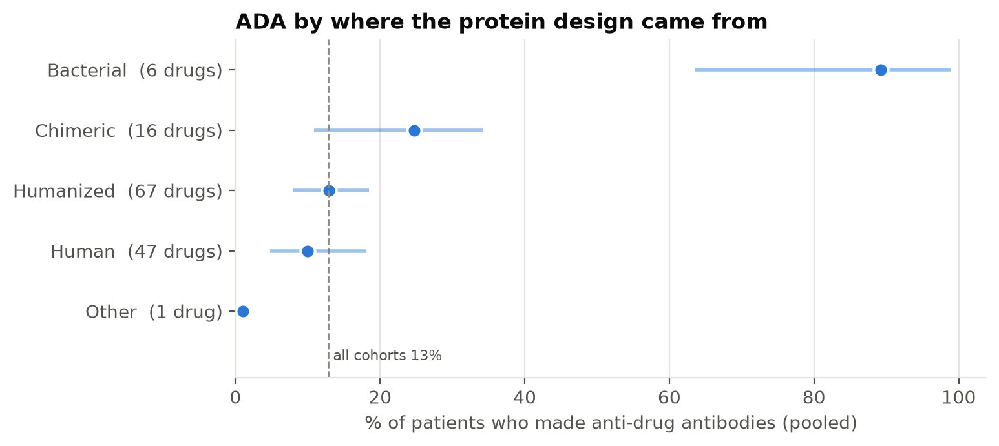
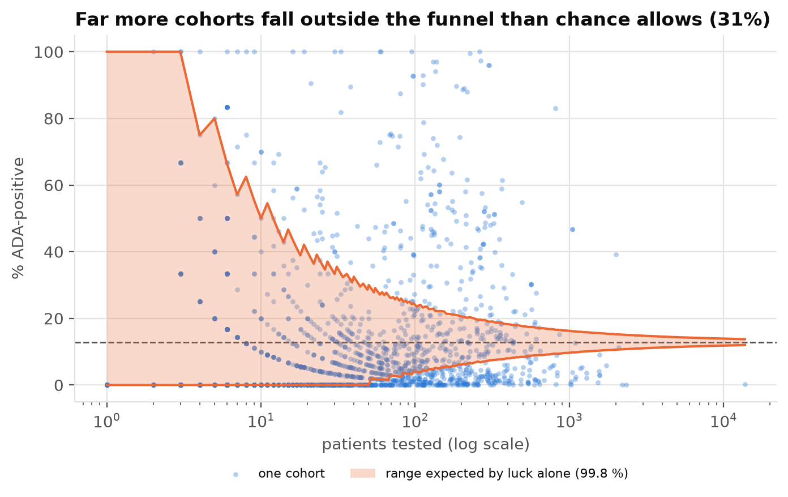
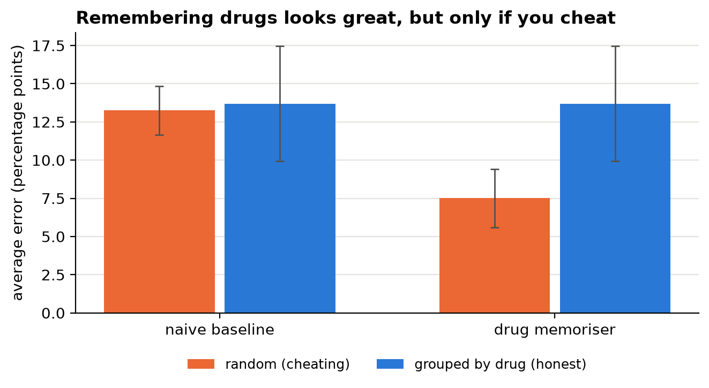
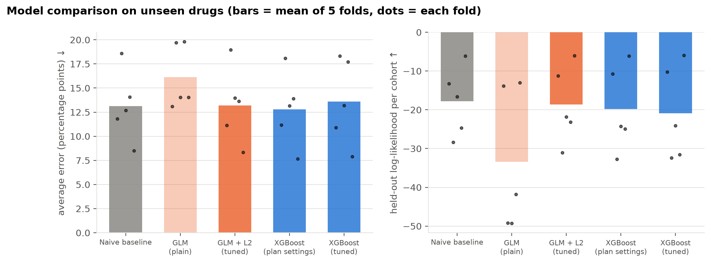
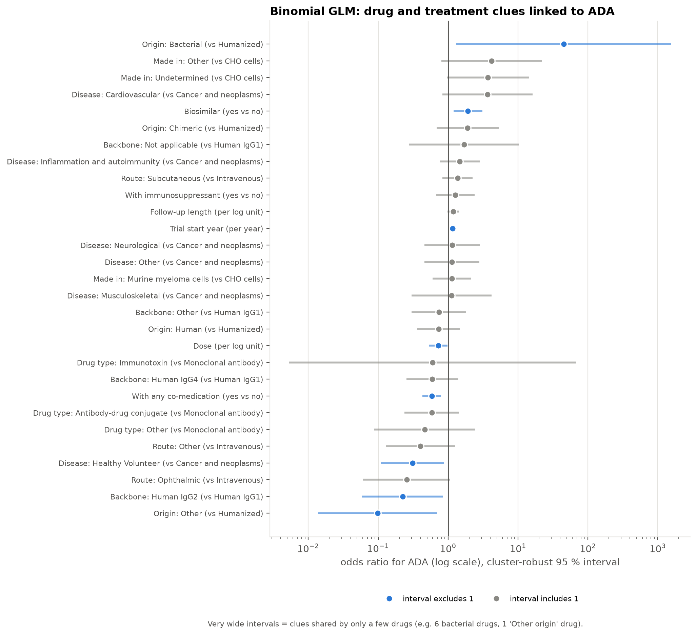

# Immuno Compass · Week 1 progress summary

**Project:** Data-driven prediction and analysis of immunogenicity in therapeutic biologics
**Data:** Immunogenicity Database Collaborative (IDC), clinical trials, therapeutics and sequence tables
**Status:** Days 1–7 of 21 complete, on schedule. All notebooks re-run from raw data with identical results.

---

## 1. Question and set-up

Biologic drugs can trigger **anti-drug antibodies (ADAs)**. For each patient group (cohort) in a trial we know
*n* patients tested and *y* ADA-positive, so we model **y ~ Binomial(n, p)** and ask which drug, treatment and trial
factors are associated with *p*, and how well *p* can be predicted for a **drug the model has never seen**.

## 2. From raw data to an analysis table

| Step | Rows |
|---|---|
| Raw clinical-trial rows | 3,334 |
| Valid counts (y ≤ n, n > 0) | 3,281 |
| Post-treatment rows only ("Therapeutic Naive" rows are pre-dose baselines: 4 % vs 15.5 % ADA) | 2,653 |
| **One row per cohort** (same patients are measured at up to 36 timepoints; we keep the peak-ADA timepoint) | **1,754 cohorts, 137 drugs, 211,018 patients** |

Other cleaning decisions: dose parsed from free text into mg/kg (91 % coverage, stated assumptions); co-administered
immunosuppressants flagged; rare categories grouped; a latest-timepoint version kept for sensitivity analysis.

## 3. What the data look like

* Overall pooled ADA frequency: **12.9 %**. 35 % of cohorts show 0 % ADA, mostly small cohorts.
* **Strong overdispersion:** 31 % of cohorts fall outside the "chance only" funnel (≈ 0.2 % expected), dispersion ratio ≈ 39.
* **Drug origin** shows the clearest gradient: human ≈ 10 %, humanized ≈ 13 %, chimeric ≈ 25 %, bacterial ≈ 89 %.
* Raw comparisons can mislead: immunosuppressant co-medication *appears* to raise ADA, but the direction flips when each drug counts equally (confounding by disease area).

## 4. Fair evaluation: grouped cross-validation by drug

Cohorts of the same drug are not independent, so every model is tested on **drugs it has never seen** (5 folds, no
drug shared between folds). A "drug memoriser" shows why: under a random split it cuts error from 13.3 to 7.5
percentage points, but under the honest grouped split it is no better than guessing the average.

## 5. Models so far (unseen drugs, mean ± SD over 5 folds)

| Model | Weighted MAE ↓ | Weighted RMSE ↓ | Held-out log-lik ↑ |
|---|---|---|---|
| Naive baseline (training average) | 0.137 ± 0.038 | 0.189 ± 0.060 | −18.1 ± 8.0 |
| Binomial GLM | 0.198 ± 0.068 | 0.276 ± 0.098 | −39.5 ± 22.0 |
| GLM + L2 (penalty tuned by nested CV) | 0.138 ± 0.038 | 0.185 ± 0.063 | −18.5 ± 9.3 |
| GLM + L1 (penalty tuned by nested CV) | 0.138 ± 0.037 | 0.191 ± 0.061 | −19.0 ± 8.7 |
| **XGBoost (pre-specified settings)** | **0.131 ± 0.038** | **0.181 ± 0.054** | −19.2 ± 9.4 |
| XGBoost (nested-CV tuned) | 0.140 ± 0.049 | 0.190 ± 0.066 | −19.8 ± 9.9 |

**Associations found by the GLM** (cluster-robust 95 % CI, adjusted for all other features):
trial start year OR 1.15/year [1.08–1.23] (likely more sensitive assays); dose OR 0.73 per log unit [0.54–0.98];
longer follow-up OR 1.18 [1.01–1.38]; IgG2 vs IgG1 backbone OR 0.22 [0.06–0.82]; bacterial vs humanized origin OR ≈ 45 [1.3–1500].
Only 11 of 42 features remain significant once standard errors account for clustering by drug (40 of 42 with naive errors).
XGBoost relies on a similar set: dose, year, follow-up, origin, backbone, trial design.

## 6. Interpretation so far

* Trial and drug-label features capture **real but modest** signal: assay era, dose, follow-up length and drug origin.
* For a **brand-new drug**, the best model so far improves on "guess the average" by under one percentage point, which is
  smaller than the fold-to-fold variation. **Most variation in ADA is drug-specific.**
* The plain GLM over-fits (42 parameters, ~110 training drugs, overdispersed data) and is worse than the baseline.
  Regularisation only brings it back to baseline level.
* All results are **associations**, not causal effects.

## 7. Plan for weeks 2–3

| Days | Work | Question it answers |
|---|---|---|
| 8–10 | Bayesian Binomial → **Beta-Binomial** (PyMC) | Does modelling overdispersion give better-calibrated predictions and honest uncertainty? |
| 11–12 | **Sequence-derived features** (Biopython), go/no-go | Does protein sequence capture the drug-specific signal that labels miss? (78 % of cohorts have a sequence) |
| 13 | Full model comparison incl. calibration | Which model is best, and is the gap bigger than fold noise? |
| 14 | SHAP and cross-model agreement | Do the three methods agree on which factors matter? |
| 15–21 | Figures, Streamlit dashboard, presentation | Deliverables 3–4 |

**Reproducibility:** `notebooks/01`–`06` regenerate every table, figure, result file and saved model from `data/raw/`
(≈ 2.5 minutes). Shared code lives in `src/immuno.py`.
