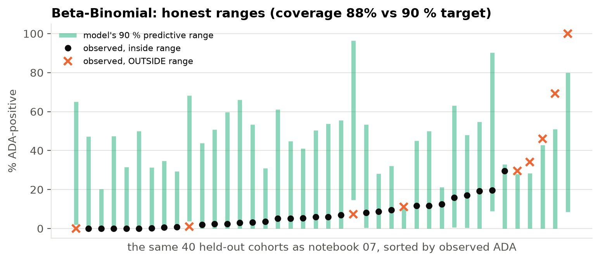
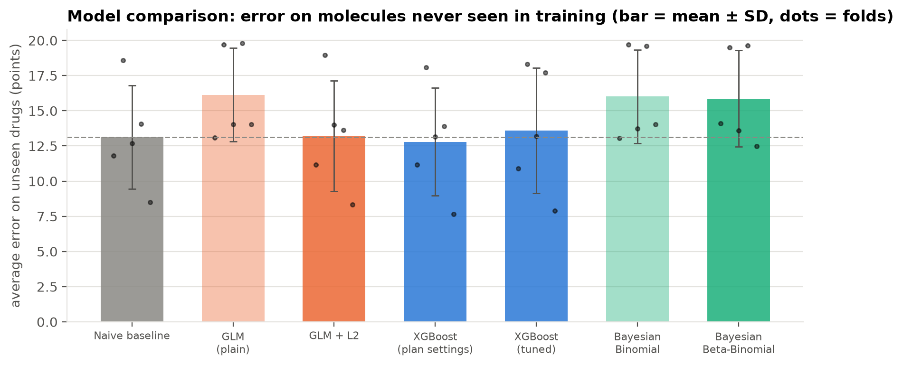
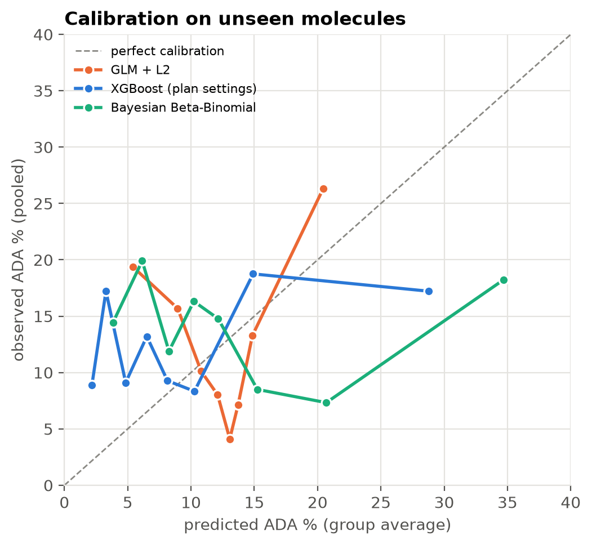
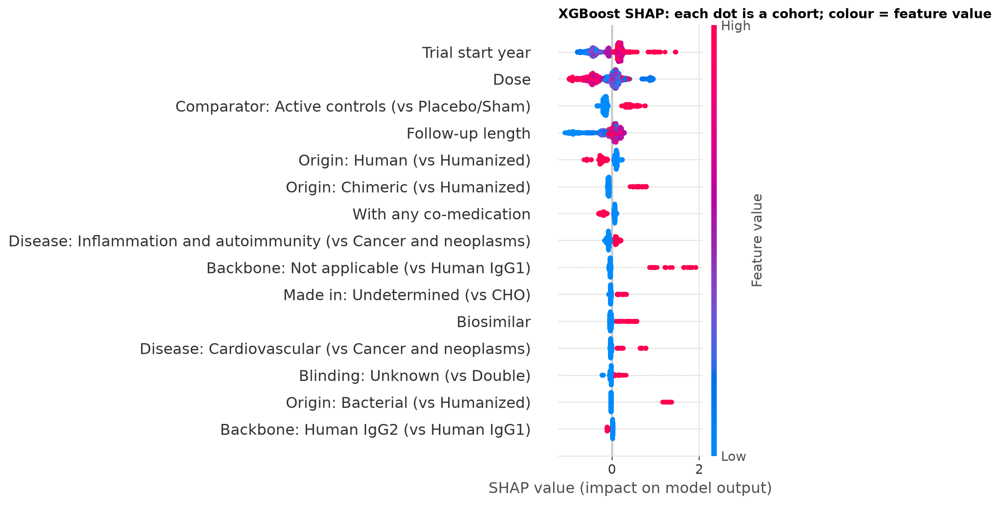

# Immuno Compass · Week 2 progress summary

**Status:** Days 8–14 of 21 complete, on schedule. Notebooks `07`–`11` added; `04`–`09` re-run after one correction (below).

---

## 1. One correction made this week (and why it matters)

Biosimilars are copies of an existing molecule (the data hold 7 adalimumab products, 7 rituximab, 6 bevacizumab…).
Our folds were first grouped by **product**, so an originator could be in training while its biosimilar was "predicted".
This showed up when sequence features (identical for biosimilars) made XGBoost look much better than it was.
**All folds and clustered errors are now grouped by molecule** (108 molecules, 137 products), and every affected notebook
was re-run. Conclusions from Week 1 are unchanged; numbers moved slightly (the summary for Week 1 is updated).

## 2. Bayesian models (notebooks 07–08)

| | Bayesian Binomial | Bayesian **Beta-Binomial** |
|---|---|---|
| Sampler (4 chains × 1,000) | r̂ = 1.00, 0 divergences | r̂ = 1.00, 0 divergences |
| Overdispersion | ignored | φ ≈ 3.6 → within-cohort correlation ρ ≈ 0.22 |
| Posterior predictive check (share of cohorts at 0 %: observed 34.7 %) | 21–24 % ✘ | 35–40 % ✔ |
| 90 % predictive interval coverage, unseen molecules | **47 %** (over-confident) | **88 %** (honest) |
| Credible intervals excluding OR = 1 | 39 / 42 | 18 / 42 |

A cohort of 1,000 patients carries about as much information about the average ADA rate as ≈ 5 independent patients.
That is why models treating every patient as independent over-fit to the largest trials.

## 3. Sequence-derived features (notebook 09): **tested, no consistent improvement**

Five whole-molecule features (length, pI, GRAVY, aromaticity, instability) cover 89 % of cohorts (104 products, 76
distinct sequences). Pre-registered rule: keep only if better on average **and** in ≥ 4/5 folds.

| model | wMAE without → with | folds improved | decision |
|---|---|---|---|
| GLM + L2 | 0.132 → 0.129 | 3/5 | no |
| XGBoost | 0.128 → 0.115 | 3/5 | no (large but inconsistent; no gain in log-likelihood) |
| Beta-Binomial | 0.159 → 0.156 | 4/5 (but worse predictive score) | no |

On the matched subset with sequences, XGBoost improves in 4/5 folds, which is a **hint** worth future work (variable-region
features, humanness scores, T-cell epitopes), but not adopted.

## 4. Final model comparison (notebook 10): unseen molecules

* **No model convincingly beats "predict the average"** for a new molecule. The best (XGBoost, pre-specified settings)
  improves weighted MAE by 0.3 points (4/5 folds), which is less than the fold-to-fold spread, and is worse on log-likelihood.
* Calibration shows models **spread predictions too widely** (over-confident about differences between molecules).
* For honest uncertainty, **Beta-Binomial models are essential**: 88–95 % coverage vs ≈ 50 % for anything assuming
  Binomial spread. The best predictive distribution is the **intercept-only Beta-Binomial**: overdispersion matters more
  than the clues.

## 5. What drives ADA? (notebook 11)

GLM, Bayesian Beta-Binomial and XGBoost-SHAP agree in direction on **32 of 42** features. Robust associations (same
direction in all three, confident in GLM and Bayes):

* **↑ more ADA:** later trial start year (assay sensitivity), bacterial origin, active-controlled / biosimilar trials
* **↓ less ADA:** higher dose, any co-medication, healthy-volunteer studies
* **Supportive (Bayes only):** the "foreignness" gradient (chimeric > humanized > human), subcutaneous > IV, longer
  follow-up, antibody-drug conjugates lower

All are **associations in observational trial data**; several probably reflect *how* ADA is measured rather than biology.

## 6. Week 3 plan

| Days | Work |
|---|---|
| 15 | Final figures (plain-language titles, consistent style) |
| 16–17 | Streamlit dashboard: explore data, predict with XGBoost + Bayesian Beta-Binomial range, model comparison |
| 18 | Clean end-to-end re-run, final write-up |
| 19–21 | Presentation, script, rehearsal |
